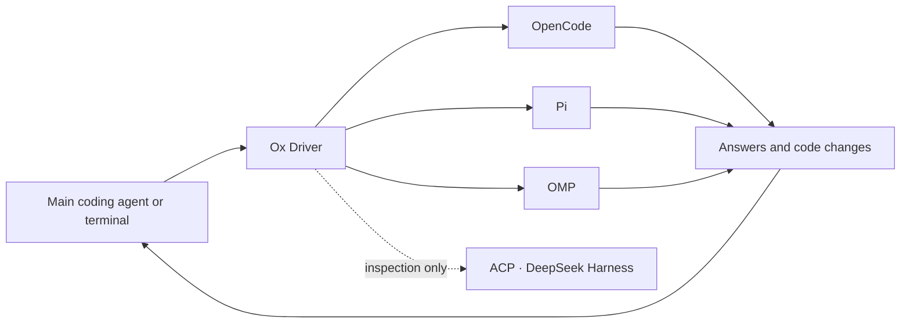
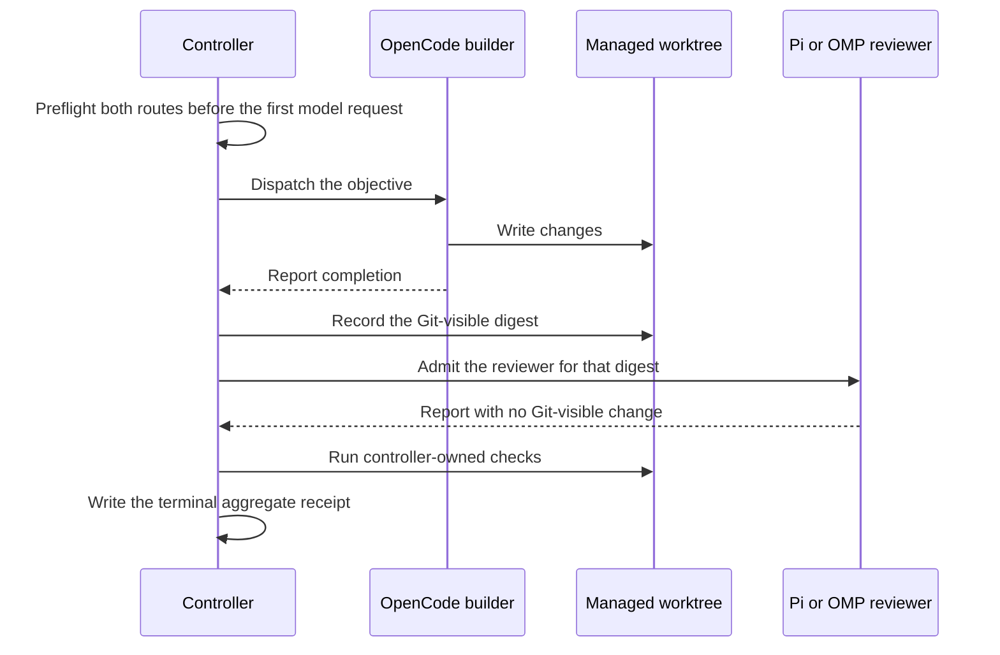

# Ox Driver

Ox Driver dispatches repository tasks to OpenCode, Pi, and OMP and returns
each worker's answers, code changes, and run receipt. Use it from Claude Code,
Codex, Gemini, another coding agent, or a terminal.

Run one worker, start independent workers together, or order tasks with
dependencies. Each harness uses its own installation and authentication.
Ox Driver preserves the provider, model, and reasoning effort you select.



## How Ox Driver coordinates the work

Ox Driver starts independent tasks together and waits for dependencies before
starting later tasks. A reviewer can inspect a writer's completed worktree.
Retries preserve the recorded route, and each worker contributes a receipt.

For writing tasks, Ox Driver compares changed files with the paths you assign
and runs your checks. You can prepare selected patches in a separate
integration worktree. Each receipt records the worker's answer, route, usage,
changed files, and check results. You decide which changes enter your repository.

Each OpenCode writer runs in a managed Git worktree that Ox Driver creates from
`HEAD`. Pi and OMP run in the directory you name. Before running a Pi writer,
create a disposable worktree and pass its path to Ox Driver.

## Harnesses

Install each selected harness separately and configure its authentication
outside Ox Driver.

- [OpenCode](https://opencode.ai) is a terminal coding agent. Ox Driver reads
  its JSON event stream. See [OpenCode routes and work](skills/ox-driver/references/opencode.md).
- [Pi](https://pi.dev) is a terminal coding agent. Its direct routes accept
  optional launcher version and digest pins. See [Pi routes and work](skills/ox-driver/references/pi.md).
- [OMP](https://omp.sh) is a coding agent with an RPC interface. Ox Driver's
  attested qualification covers version `18.0.6` and its recorded macOS arm64
  launcher digest. See [OMP routes and review](skills/ox-driver/references/omp.md).
- [ACP](https://agentclientprotocol.com) is an agent protocol. The adapter
  inspects an installed agent's launcher and profile.
- [DeepSeek Harness](https://github.com/deepseek-ai/deepseek-harness) is an agent
  SDK. The adapter inspects an installed `0.1.1-rc.2` artifact tree.

Ox Driver uses each route profile's launcher command. A command such as
`opencode` or `pi` resolves through `PATH`. To select a specific launcher,
pass its absolute path to `init-opencode`, `init-pi`, or `init-omp` with
`--launcher`.

| Harness | Dispatchable work | Composition | Boundary |
| --- | --- | --- | --- |
| OpenCode | One-writer repository tasks | Solo, handoff builder, pair, team, dependencies, retry, checked integration, native direct children | Trusted host. Managed worktrees separate Git changes but provide no OS sandbox. |
| Pi | Writing or read-only review | Solo writer, solo reviewer, handoff reviewer, team, dependencies, retry, checked integration from team writers | Trusted host. You create a disposable worktree for writers. Ox Driver does not select Pi child profiles. |
| OMP | Read-only review | Solo reviewer, handoff reviewer, mixed team, dependencies, retry | Attested. Requires a qualified macOS arm64 route. Writing and child agents are unavailable. |
| ACP | None | None | Zero-model inspection only. Preflight rejects every task dispatch. |
| DeepSeek Harness | None | None | Artifact inspection only. Preflight rejects every task dispatch. |

`doctor`, validation, preflight, and tests make no model request. ACP and
DeepSeek Harness never receive a task prompt through Ox Driver.

## What a receipt records

Ox Driver writes one JSON receipt per run under its state root, outside the
target repository. This synthetic example shows selected fields. The full
record includes timestamps, worker output, check output, changed paths from
the harness and acceptance commands, effective-power settings, a patch
reference, and notices.

```json
{
  "version": 1,
  "tier": "trusted-host",
  "runId": "example-run-0001",
  "adapterId": "opencode-v2",
  "harness": "opencode",
  "harnessVersion": "1.18.23",
  "status": "completed",
  "requestedRouteProfile": "opencode-default",
  "routeProfileSha256": "0f1e2d3c4b5a69788796a5b4c3d2e1f00f1e2d3c4b5a69788796a5b4c3d2e1f0",
  "configuredRoute": { "provider": "openrouter", "model": "z-ai/glm-5.3-flash", "reasoning": "max" },
  "costReport": { "mode": "report-only", "ceilingUsdMicros": 50000, "observedUsdMicros": 4180, "status": "within-ceiling" },
  "usage": { "providerRequests": 7, "toolCalls": 8, "childrenStarted": 0, "reportedCostUsdMicros": 4180, "complete": true, "sources": ["harness"] },
  "initialWorkspaceSha256": "1a2b3c4d5e6f708192a3b4c5d6e7f8091a2b3c4d5e6f708192a3b4c5d6e7f809",
  "postAdapterWorkspaceSha256": "2b3c4d5e6f708192a3b4c5d6e7f8091a2b3c4d5e6f708192a3b4c5d6e7f8091a",
  "finalWorkspaceSha256": "2b3c4d5e6f708192a3b4c5d6e7f8091a2b3c4d5e6f708192a3b4c5d6e7f8091a",
  "changedPaths": ["src/parse.mjs", "tests/parse.test.mjs"],
  "unownedChangedPaths": [],
  "acceptance": [
    {
      "command": "npm test",
      "passed": true,
      "exitCode": 0,
      "durationMs": 4120,
      "backgroundProcessesDetected": false,
      "processTreeReaped": true,
      "terminationEscalated": false
    }
  ],
  "eventsPath": "runs/example-run-0001/events.jsonl",
  "eventsSha256": "3c4d5e6f708192a3b4c5d6e7f8091a2b3c4d5e6f708192a3b4c5d6e7f8091a2b"
}
```

The three workspace digests record the worktree before dispatch
(`initialWorkspaceSha256`), after the harness returns
(`postAdapterWorkspaceSha256`), and after acceptance commands run
(`finalWorkspaceSha256`).

`changedPaths` lists every Git-visible change. `unownedChangedPaths` lists
changes outside the `--owned` scope; a non-empty list fails reconciliation.
A route that reports token counts adds `usage.tokens`.

See the [receipt schema](schemas/receipt.schema.json) for the full contract and
[receipts and handoffs](skills/ox-driver/references/receipts-and-handoffs.md)
for aggregate receipts, archives, and resume.

## Requirements

- Node.js 22.20 or later and npm
- Git
- An installed harness for each selected dispatch route
- Harness authentication configured outside route profiles

OpenCode writer tests run on macOS and Linux. OMP dispatch requires the
qualified macOS arm64 route. A Pi route must pass its zero-model doctor on the
machine that runs it.

## Install and build

Install exact dependencies without lifecycle scripts, then build the entry
points:

```bash
npm ci --ignore-scripts
npm run build
```

Inspect the bundled skill before installing it through a host agent:

```bash
npm_config_ignore_scripts=true npx --yes skills@1.5.23 add . --list
```

The skill invokes scripts from this source tree. Keep the source tree
available while using the skill.

## Command surface

The build produces two entry points:

- `packages/cli/dist/main.js` is the controller: `doctor`, `validate`,
  `preflight`, `run`, `omp-review`, `handoff`, `inspect`, `cancel`, `recover`.
- `packages/opencode-cli/dist/main.js` is the OpenCode writer: `task`,
  `doctor`, `inspect`, `tail`, `cancel`, `recover`.

Both print usage lines that begin with `ox-driver`.
`npm exec -- ox-driver-opencode` invokes the OpenCode entry point through its
installed bin name. Scripts under `scripts/` handle routes, workspaces, pairs,
dependency-aware teams, orchestration, and integration.

## Configure routes

Each dispatch route names one launcher, provider, model, and reasoning effort.
The initializer writes route identity and optional executable checks. It never
writes authentication values.

Set the provider, model, and reasoning effort that your installed launcher
accepts:

```bash
provider_id="openrouter"
model_id="z-ai/glm-5.3-flash"
effort="max"
```

Ox Driver records these strings in the route profile and passes them to the
launcher unchanged. The example requires a launcher that accepts `max` as its
reasoning effort.

Create an OpenCode route:

```bash
node scripts/ox_route.mjs init-opencode \
  --launcher opencode \
  --provider "$provider_id" \
  --model "$model_id" \
  --reasoning "$effort"
node scripts/ox_route.mjs check --id opencode-default
```

Create a direct Pi route:

```bash
node scripts/ox_route.mjs init-pi \
  --launcher pi \
  --provider "$provider_id" \
  --model "$model_id" \
  --reasoning "$effort"
node scripts/ox_route.mjs check --id pi-default
```

Create an OMP route. The initializer creates the isolated agent and home
directories when they do not exist:

```bash
node scripts/ox_route.mjs init-omp \
  --launcher omp \
  --provider "$provider_id" \
  --model "$model_id" \
  --reasoning "$effort" \
  --agent-dir /absolute/path/to/omp-agent \
  --home-dir /absolute/path/to/omp-home
node scripts/ox_route.mjs check --id omp-default
```

Pass `--expected-version` or `--expected-sha256` to check the launcher's version
or digest. A digest mismatch blocks launcher execution. The published OMP
attested qualification covers only 18.0.6 and its documented digest.

OMP accepts repeated `--env NAME` arguments for environment-variable names
admitted to its process. The profile records the names; supply the values
through the process environment.

Check every configured harness without making a model request:

```bash
node packages/cli/dist/main.js doctor --all
```

List configured routes, their status, and launcher pins without running a
launcher:

```bash
node scripts/ox_route.mjs list
```

The listing reports invalid profiles individually. `--profile-dir` and
`OX_DRIVER_ROUTE_PROFILE_DIR` select the route directory.

Read [OpenCode routes and work](skills/ox-driver/references/opencode.md),
[Pi routes and work](skills/ox-driver/references/pi.md), and
[OMP routes and review](skills/ox-driver/references/omp.md) before the first
paid dispatch.

## Run one OpenCode writer

```bash
node packages/opencode-cli/dist/main.js task /absolute/path/to/repository \
  "Implement one focused change and report the result" \
  --route opencode-default \
  --owned . \
  --check "npm test"
```

The command creates a detached managed worktree from `HEAD`, runs one writer,
then records route, usage, reported cost, process cleanup, Git-visible changes,
and acceptance results. It preserves the worktree for inspection.

Use `--no-check` only when no executable acceptance command applies. Repeat
`--owned`, `--exclude`, and `--check` to state a narrower contract.

## Run a team

An Ox Driver team contains two to 32 lanes in any combination of OpenCode, Pi,
and OMP. Install the harnesses named by the plan. Each lane declares an ID,
role, harness, objective, and worktree. Optional fields select the route,
writer policy, dependencies, scope, checks, timeout, and reported-cost target.

Independent lanes run in parallel. A lane with `dependsOn` starts after its
dependencies complete and receives their bounded output, changed paths, run
identifiers, and terminal workspace digests. Reusing a worktree is allowed
only along an ordered dependency chain; the next lane is admitted against the
previous lane's exact terminal digest. OpenCode lanes may also use their native
direct children inside one lane.


Create a managed worktree for every independent writer or review branch. An
ordered reviewer may reuse its writer's worktree.

```bash
node scripts/ox_workspace.mjs create /absolute/path/to/repository
```

```json
{
  "version": 1,
  "lanes": [
    {
      "id": "research", "role": "researcher", "harness": "pi",
      "objective": "Inspect the design and identify the smallest safe change",
      "workerPath": "/absolute/path/to/research-worktree",
      "route": "pi-default"
    },
    {
      "id": "build", "role": "builder", "harness": "pi",
      "writerPolicy": "one-writer", "dependsOn": ["research"],
      "objective": "Implement the accepted design",
      "workerPath": "/absolute/path/to/build-worktree",
      "route": "pi-default", "ownedPaths": ["src", "tests"],
      "checks": ["npm test"]
    },
    {
      "id": "review", "role": "reviewer", "harness": "omp",
      "writerPolicy": "read-only", "dependsOn": ["build"],
      "objective": "Review the exact terminal implementation",
      "workerPath": "/absolute/path/to/build-worktree",
      "route": "omp-default", "checks": ["npm test"]
    },
    {
      "id": "synthesis", "role": "synthesizer", "harness": "pi",
      "dependsOn": ["review"],
      "objective": "Summarize the result, remaining risks, and evidence",
      "workerPath": "/absolute/path/to/synthesis-worktree",
      "route": "pi-default"
    }
  ]
}
```

```bash
node scripts/ox_team.mjs validate /absolute/path/to/plan.json
node scripts/ox_team.mjs run /absolute/path/to/plan.json --concurrency 4
```

`validate` resolves the plan, route profiles, runner identities, and worktree
paths. It reports dependency order, scope, checks, timeouts, and cost targets
without allocating an orchestration or starting a launcher. `run --dry-run`
performs the same validation. Use `doctor` to qualify each installed harness
before dispatch.

OpenCode lanes are writers and may select `agent` and `childAgents`. Pi lanes
default to read-only and may declare `writerPolicy: "one-writer"` with at least
one owned path. OMP lanes are read-only. Pi review lanes run without shell
checks; OMP review lanes may run controller-owned checks after review.

Use the same pattern with four Pi lanes when Pi is the only installed harness,
four OpenCode lanes when OpenCode is the only installed harness, or four OMP
review lanes when OMP is the only installed harness. A plan fails before
allocation when it names an unavailable capability, an unknown dependency, a
cycle, or an unordered shared worktree.

To run two OpenCode writers on one objective, use a pair:

```bash
node scripts/ox_pair.mjs "Implement two independent approaches" \
  --worker /absolute/path/to/worktree-a \
  --worker /absolute/path/to/worktree-b \
  --check "npm test"
```

Pair and team runs collect every independent lane result by default. Select
`--failure-policy fail-fast` only when the remaining lanes must stop after one
failure.

## Run a checked handoff

A handoff orders one OpenCode writer and one reviewer, and binds the reviewer
to the exact Git-visible state the writer produced.



A workspace change between the recorded digest and reviewer admission fails the
handoff, so a reviewer never reports on a tree the writer did not produce.

```bash
node packages/cli/dist/main.js handoff \
  /absolute/path/to/repository \
  "Implement one focused change" \
  --owned . \
  --builder-route opencode-default \
  --reviewer pi \
  --reviewer-route pi-default \
  --check "npm test"
```

To select OMP, pass `--reviewer omp --reviewer-route omp-default`. To resume an
interrupted or failed reviewer stage, use the checkpoint identifier that the
original command prints:

```bash
node packages/cli/dist/main.js handoff resume HANDOFF_CHECKPOINT_ID
```

## Run Pi

In a disposable worktree you created, run a solo Pi writer with at least one
owned path:

```bash
node scripts/ox_pi.mjs /absolute/path/to/worktree \
  "Implement one focused change and report the result" \
  --route pi-default \
  --writer \
  --owned . \
  --check "npm test"
```

Run a solo read-only Pi review:

```bash
node scripts/ox_pi.mjs /absolute/path/to/repository \
  "Review this repository for correctness risks" \
  --route pi-default
```

The writer receives the installed launcher's normal tool surface. The reviewer
receives the controller's read-only tool policy. Both preserve the selected
provider, model, effort, and configured network behavior. Put either mode in a
Pi-only or mixed team by declaring `harness: "pi"` in the lane plan.

## Run an OMP review

```bash
node packages/cli/dist/main.js omp-review \
  /absolute/path/to/repository \
  "Review this repository for correctness risks" \
  --route omp-default \
  --no-check
```

OMP review is ephemeral and read-only. The qualified route verifies the
launcher, route, isolated runtime directories, tool inventory, process
containment, and unchanged Git-visible workspace. An OMP lane can review a
dependency's exact terminal worktree inside any team plan.

## Inspect, retry, and integrate

```bash
node scripts/ox_team.mjs list
node scripts/ox_team.mjs inspect ORCHESTRATION_ID
node scripts/ox_team.mjs report ORCHESTRATION_ID
node scripts/ox_team.mjs report ORCHESTRATION_ID --resolved
node scripts/ox_team.mjs retry ORCHESTRATION_ID --lane LANE_ID
node scripts/ox_team.mjs propose ORCHESTRATION_ID
```

`retry` reruns one incomplete lane in its recorded worktree and preserves the
recorded route-profile digest, agent, scope, checks, timeout, and cost target.
When several failed lanes share dependencies, retry restores their order,
passes the latest completed dependency evidence forward, and rebinds a shared
worktree lane to the newest dependency digest.

`report --resolved` combines each root lane's latest attempt across the selected
retry chain. It retains earlier attempts and cumulative cost evidence. A later
failed attempt stays visible; missing cost remains unknown. Add `--resolved`
to `propose`, `export`, or `apply` to use those combined lane results.
Resolved views require recorded effective lane plans, as pair and team
receipts provide.

`propose` reports patch sources, overlaps, conflicts, and apply order without
changing a repository. An explicit `apply` creates a separate integration
worktree and runs controller-owned checks:

```bash
node scripts/ox_integrate.mjs apply ORCHESTRATION_ID \
  --lane writer-a \
  --repo /absolute/path/to/repository \
  --check "npm test"
```

Apply writes a durable integration receipt with the selected runs, patch
hashes, base commit, checks, and final workspace digest. Its output includes
an `integrationId` and `receiptSha256`. Inspect that receipt in a later session:

```bash
node scripts/ox_integrate.mjs inspect INTEGRATION_ID --expected-sha256 DIGEST
```

The expected digest verifies the saved receipt. It does not recheck the live
worktree. A snapshot or receipt-storage failure reports `evidence-failed` and
preserves the worktree for inspection.

## Operating boundaries

- Trusted-host OpenCode and Pi receive the host access available to their
  installed launchers. Use repositories and worktrees appropriate for that
  access.
- Managed worktrees separate Git changes. They do not restrict filesystem or
  network access.
- `--owned` and `--exclude` classify Git-visible changes after execution. A
  change outside the admitted scope fails reconciliation.
- Trusted-host cost targets evaluate reported cost after execution. Configure
  a provider or launcher limit when a task requires a hard spending cap.
- OMP claims only the qualified read-only macOS arm64 boundary.
- Ox Driver stores objectives, absolute paths, output, events, receipts,
  patches, and managed worktrees under its configured state roots.
- Keep authentication values out of route profiles, tasks, prompts, receipts,
  repositories, and documentation.

Inspect writer diffs and receipts before you integrate any lane.

## Contributing and license

Read [Security](SECURITY.md) and [Contributing](CONTRIBUTING.md). Ox Driver is
licensed under MIT.
